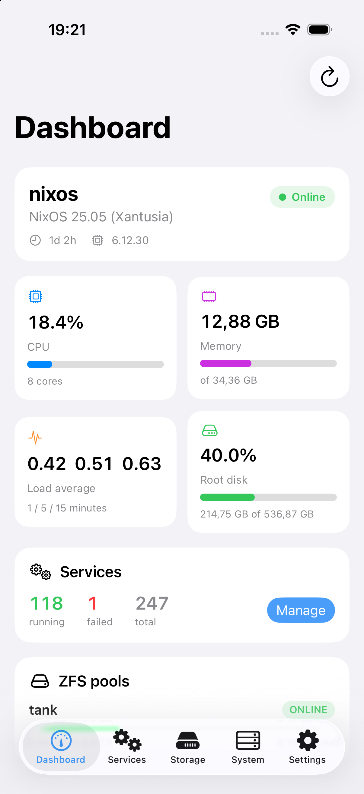
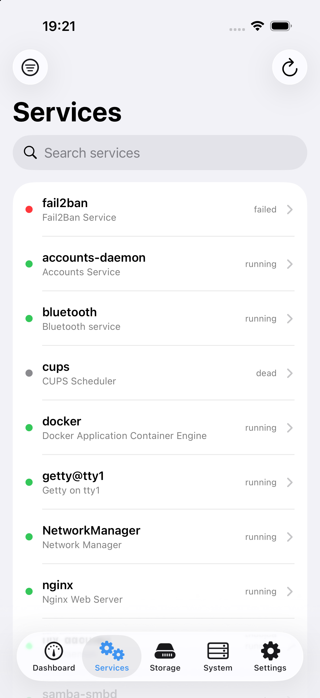
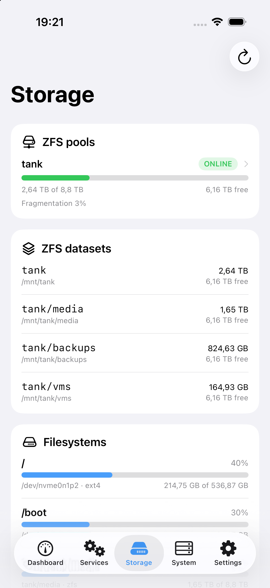
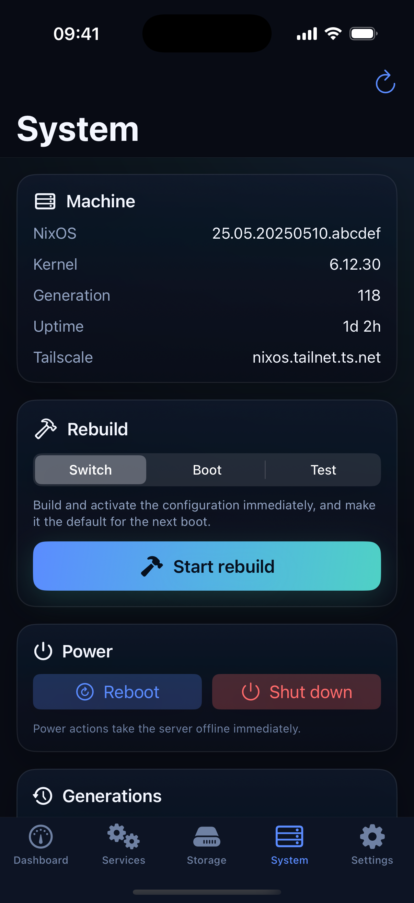
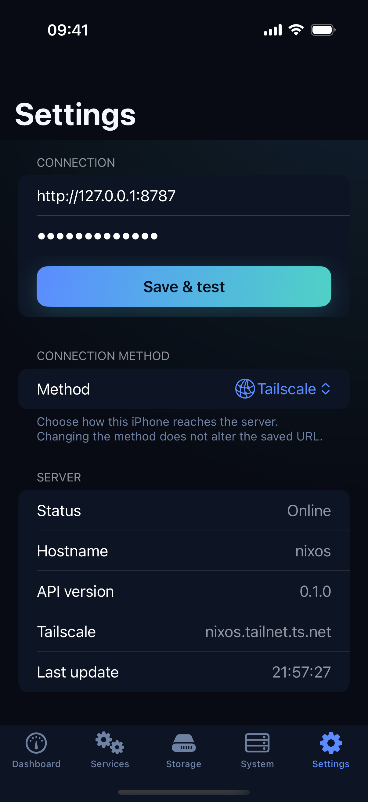
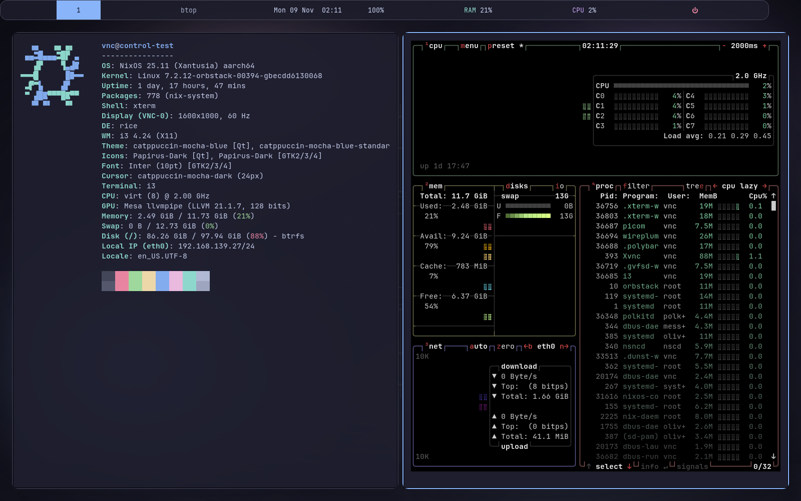
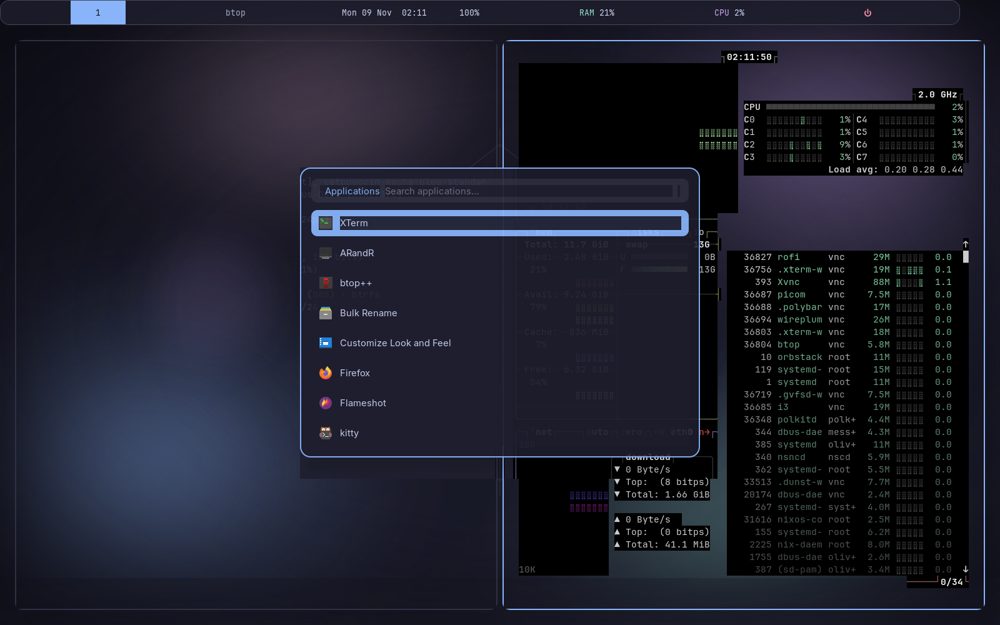
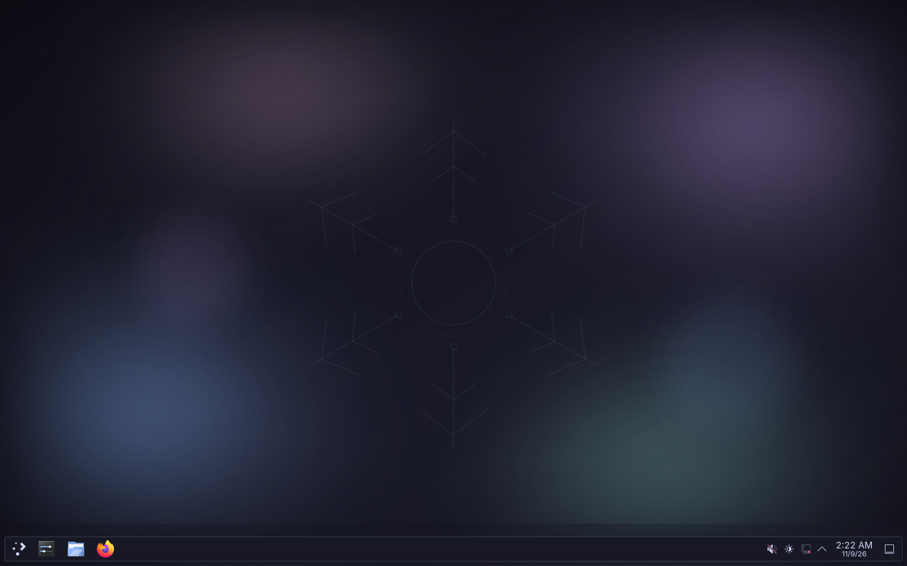

# NixOS Control

An iPhone app for monitoring and managing a NixOS machine, backed by a small authenticated API server that runs on the machine itself.

<p align="center">
  
  
  
  
  
</p>

<p align="center"><em>Screenshots use fixture data from the iOS Simulator.</em></p>

## Features

- **Dashboard** — hostname, NixOS/kernel version, uptime, CPU usage, memory, load, root disk, ZFS pool health, temperatures, IP addresses, and Tailscale state.
- **Services** — search and filter systemd units, start/stop/restart, enable/disable at boot, and read journal logs.
- **Storage** — ZFS pool usage and health, `zpool status`, datasets, and filesystem usage.
- **System** — NixOS generations, `nixos-rebuild switch/boot/test` with live job output and cancellation, reboot, and shutdown.
- **Secure by default** — the server binds to `127.0.0.1`, authenticates every request with a 256-bit bearer token, and is exposed over Tailscale Serve with automatic HTTPS. No router ports are opened.
- **Tailscale or WireGuard** — the iPhone reaches the machine through the tailnet, or through the WireGuard VPN that already runs on your FRITZ!Box.

## Desktop profiles

The host configuration now selects a desktop profile instead of hard-coding
XFCE. The original setup remains the default; switch by changing one value.

<p align="center">
  
  
</p>
<p align="center"><em>The <code>rice</code> profile in the OrbStack VM: i3, polybar, picom, Rofi, xterm and Catppuccin Mocha.</em></p>

<p align="center">
  
</p>
<p align="center"><em>The <code>plasma</code> profile: KDE Plasma 6 with the Catppuccin KDE theme and the same wallpaper.</em></p>

| Profile | What you get |
| --- | --- |
| `xfce` | The original XFCE desktop (default), now with the Catppuccin GTK theme, icons, cursor and fonts. |
| `rice` | A Catppuccin Mocha i3 rice: polybar, picom, Rofi, dunst, xterm, Thunar and Firefox. Works over VNC and xrdp. |
| `plasma` | KDE Plasma 6 with the Catppuccin KDE colour scheme, window decoration and SDDM login theme. Works over the VM's X11 VNC display too. |
| `hyprland` | Hyprland + waybar + mako + Rofi + hyprpaper/hypridle. Wayland only; xrdp is disabled for this profile. |

```nix
myDesktop = {
  enable = true;
  profile = "rice";          # xfce | rice | plasma | hyprland
  user = "nixos";
  flavour = "mocha";         # mocha | macchiato | frappe | latte
  accent = "blue";
  gtkTheme = "catppuccin";   # catppuccin | whitesur
};
```

Then rebuild:

```bash
sudo nixos-rebuild switch
```

### WhiteSur GTK theme

The GTK, icon and cursor theme is independent of the desktop profile. Set
`myDesktop.gtkTheme = "whitesur"` to use the macOS-like
[WhiteSur GTK theme](https://github.com/vinceliuice/WhiteSur-gtk-theme)
instead of Catppuccin:

```nix
myDesktop = {
  enable = true;
  profile = "rice";
  user = "nixos";
  gtkTheme = "whitesur";

  whiteSur = {
    variant = "dark";        # light | dark
    accent = "blue";         # default | blue | purple | pink | red | orange | yellow | green | grey
    icons = true;            # WhiteSur icon theme (Papirus-Dark if false)
    cursors = true;          # WhiteSur cursors (Catppuccin cursors if false)
  };
};
```

WhiteSur is installed from the `whitesur-gtk-theme`, `whitesur-icon-theme`
and `whitesur-cursors` nixpkgs packages. The Catppuccin SDDM and Qt/Kvantum
themes remain in place, so the login screen and Qt applications keep their
Catppuccin styling. Rebuild to switch; setting `gtkTheme = "catppuccin"` (the
default) restores the previous look.

### Dedicated Hyprland config

On real hardware, the repository includes a dedicated wrapper and switch
script, so you do not have to edit `configuration.nix` to try Hyprland:

```bash
./switch-hyprland.sh dry-build   # evaluate/build only
./switch-hyprland.sh switch      # make Hyprland the active session
```

`configuration-hyprland.nix` imports the normal configuration and only forces
`myDesktop.profile = "hyprland"`. The profile is Wayland-only and disables xrdp.
Revert with `sudo nixos-rebuild switch`.

The Hyprland session also starts `wayvnc` on `127.0.0.1:5900` so you can reach
it from another machine without opening a public port:

```bash
ssh -L 5900:127.0.0.1:5900 <user>@<host>
open vnc://127.0.0.1:5900
```

If the host has no monitor, a headless `HEADLESS-VNC` output is created
automatically. VNC is bound to loopback; use the SSH tunnel or Tailscale rather
than exposing port 5900.

The dedicated config also enables SDDM auto-login so the Hyprland session (and
`wayvnc`) starts without a physical login. Remove the
`services.displayManager.autoLogin` block from `configuration-hyprland.nix` if
you prefer to log in manually.

> OrbStack has no DRM device and cannot run a real Hyprland session; Hyprland's
> headless/nested backend fails without `/dev/dri`. Use the `rice` or `plasma`
> profile in the VM and Hyprland on the host.

The theme files are declarative: edit `desktop/rice/...`,
`desktop/hyprland/...` or `desktop/wallpaper.svg` and rebuild. Dotfiles are
linked from the Nix store into `~/.config`; they are read-only by design.

The rice starts picom's GLX backend (blur, rounded corners, shadows) when a
DRM device is present, and falls back to XRender in the GPU-less OrbStack VM.

The non-XFCE profiles use SDDM with the Catppuccin theme; XFCE keeps lightdm.
`myDesktop.enableDisplayManager = false` is available for machines that start
a session themselves (the OrbStack VM does this).

### Rice keybindings

| Keys | Action |
| --- | --- |
| `Super+Return` / `Super+Shift+Return` | xterm / kitty |
| `Super+D` | Rofi application launcher |
| `Super+Tab` | Rofi window switcher |
| `Super+B` / `Super+E` | Firefox / Thunar |
| `Super+Q` | close window |
| `Super+1…0` / `Super+Shift+1…0` | switch / move workspace |
| `Super+R` | resize mode |
| `Super+Escape` | lock |
| `Super+Shift+X` | power menu |
| `Super+Shift+S` | screenshot |
| `Super+Shift+C` / `Super+Shift+R` | reload / restart i3 |

## Architecture

```text
┌─────────────┐      HTTPS (Tailscale)      ┌──────────────────────────┐
│  iPhone app │ ──────────────────────────► │  tailscale serve :443    │
└─────────────┘                             └────────────┬─────────────┘
                                                         │ HTTP localhost
                                                         ▼
                                            ┌──────────────────────────┐
                                            │ nixos-control (Rust)     │
                                            │ 127.0.0.1:8787           │
                                            └────────────┬─────────────┘
                                                         │
                                      systemd · journalctl · zfs · nixos-rebuild
                                                         ▼
                                            ┌──────────────────────────┐
                                            │        NixOS host        │
                                            └──────────────────────────┘
```

## Repository layout

```text
configuration.nix          Existing NixOS config (now imports the module)
nixos-control.nix          NixOS module: packages and runs the server
desktop/                   Desktop profile selector, Catppuccin themes, wallpaper
server/                    Rust API server (Cargo crate)
archive/server-go/         Original Go implementation, kept for reference
ios/                       SwiftUI app and XcodeGen project
website/                   Marketing site and documentation (Docusaurus)
docs/screenshots/          App screenshots
```

## Website and documentation

The marketing site lives at `/` and the documentation at `/docs`. Both are
built from `website/` with [Docusaurus](https://docusaurus.io/).

Live site: <https://403access.github.io/nixos/>

Every push to `main` triggers the **Deploy website** workflow
(`.github/workflows/deploy-website.yml`), which builds the site and publishes it
to GitHub Pages. To enable it the first time, set **Settings → Pages → Build and
deployment → Source** to **GitHub Actions**.

Run the site locally:

```bash
cd website
npm install
npm run start    # http://localhost:3000/nixos/
npm run build    # production output in website/build
```

## Deploy the server

The server is a Rust program packaged with `rustPlatform.buildRustPackage`, so there is nothing to install manually on the NixOS machine.

1. Put this repository at `/etc/nixos` (or copy `configuration.nix`, `nixos-control.nix`, and the `server/` directory there). The existing config already contains:

   ```nix
   imports = [
     ./hardware-configuration.nix
     ./nixos-control.nix
   ];

   services.nixos-control.enable = true;

   services.tailscale.enable = true;
   networking.firewall.trustedInterfaces = [ "tailscale0" ];
   ```

2. Rebuild:

   ```bash
   sudo nixos-rebuild switch
   ```

   The first start generates `/var/lib/nixos-control/token`.

3. Set up Tailscale:

   ```bash
   sudo tailscale up
   ```

   In the [Tailscale admin console](https://login.tailscale.com/admin/dns):
   - Enable **MagicDNS**.
   - Enable **HTTPS Certificates**.

   Then start the Serve unit (it may already be running and retrying):

   ```bash
   sudo systemctl restart nixos-control-tailscale-serve
   sudo systemctl status nixos-control nixos-control-tailscale-serve
   sudo tailscale serve status
   ```

   The Serve unit runs:

   ```bash
   tailscale serve --bg --https=443 http://127.0.0.1:8787
   ```

4. Read the API token:

   ```bash
   sudo nixos-control-token
   # or: sudo cat /var/lib/nixos-control/token
   ```

5. Verify the API:

   ```bash
   TOKEN=$(sudo nixos-control-token)
   curl -s -H "Authorization: Bearer $TOKEN" \
     "https://<machine>.<tailnet>.ts.net/api/health"
   ```

   Use the machine name shown by `tailscale status` and your tailnet's
   `ts.net` domain.

   You should see `{"ok":true,"version":"0.1.0",...}`.

   > **Using FRITZ!Box WireGuard instead?** Skip the Tailscale steps and follow
   > the [WireGuard section](#wireguard-and-lan-access) below.

   > `nixos-control` deliberately does not restart itself during
   > `nixos-rebuild` (so an in-flight rebuild cannot kill its own process).
   > After changing the server or this module, run
   > `sudo systemctl restart nixos-control` manually.

## Build the iOS app

Requirements: Xcode 26 or newer, [XcodeGen](https://github.com/yonaskolb/XcodeGen) (`brew install xcodegen`), and iOS 17+.

```bash
cd ios
xcodegen generate
open NixOSControl.xcodeproj
```

In Xcode:

1. Select the **NixOSControl** target → **Signing & Capabilities**.
2. Choose your personal team. Change the bundle identifier if Xcode asks.
3. Connect your iPhone, select it as the run destination, and press **Run**.
4. On the phone, trust the developer certificate if prompted: **Settings → General → VPN & Device Management**.

> The AppIcon asset is intentionally empty. Add a 1024×1024 PNG to
> `ios/NixOSControl/Resources/Assets.xcassets/AppIcon.appiconset` if you want a
> custom home-screen icon.

On first launch, choose a connection method and enter:

- **Server URL**: `https://<machine>.<tailnet>.ts.net` for Tailscale, or `http://<LAN-IP>:8787` over WireGuard (no trailing slash)
- **API token**: the value from `sudo nixos-control-token`

Tap **Save & Connect**.

> The app stores the token in the iOS Keychain. The URL and connection method are stored in `UserDefaults`. Bare IP addresses, single-label hostnames, `.local` names and `.fritz.box` hostnames default to `http://`.

### WireGuard and LAN access

The module already supports an existing FRITZ!Box WireGuard VPN; no WireGuard configuration is needed on the NixOS host. Set:

```nix
services.nixos-control = {
  address = "0.0.0.0";
  openFirewall = true;
  tailscaleServe.enable = false;
};
```

Rebuild and restart the server so the listen address changes:

```bash
sudo nixos-rebuild switch
sudo systemctl restart nixos-control
```

Then connect to `http://<LAN-IP>:8787` with the WireGuard tunnel active. The app exposes both **Tailscale** and **WireGuard** presets in setup and Settings. WireGuard encrypts the phone-to-router leg; direct LAN access is unencrypted, so use it only on a trusted network. The app allows plain HTTP (`NSAllowsArbitraryLoads`) to support this; Tailscale HTTPS remains the recommended path when away from home without a VPN.

See the [FRITZ!Box WireGuard guide](website/docs/guides/fritzbox-wireguard.md) for the router steps.

## Configuration options

| Option | Default | Description |
| --- | --- | --- |
| `services.nixos-control.enable` | `false` | Enable the API server |
| `address` | `127.0.0.1` | Listen address |
| `port` | `8787` | Listen port |
| `openFirewall` | `false` | Open the port in the firewall on all interfaces |
| `tokenFile` | `/var/lib/nixos-control/token` | Bearer-token file, generated if missing |
| `flake` | `null` | When set, rebuilds use `--flake <value>` |
| `allowRebuild` | `true` | Allow `nixos-rebuild` actions |
| `allowPower` | `true` | Allow reboot/shutdown |
| `tailscaleServe.enable` | `true` | Expose the API via Tailscale Serve |
| `tailscaleServe.httpsPort` | `443` | HTTPS port used by Tailscale Serve |

### Flakes

The current `configuration.nix` is channel-based, so the default `nixos-rebuild switch` is used. If you migrate to flakes, set the flake reference:

```nix
services.nixos-control.flake = "/etc/nixos#nixos";
```

With a git-backed flake, make sure `server/` and `nixos-control.nix` are tracked (`git add`), otherwise Nix will not see them.

### Read-only mode

If you only want monitoring:

```nix
services.nixos-control = {
  enable = true;
  allowRebuild = false;
  allowPower = false;
};
```

The app reads these capabilities from `/api/status` and hides the corresponding actions.

## API

Every route requires:

```http
Authorization: Bearer <token>
```

| Method | Path | Purpose |
| --- | --- | --- |
| `GET` | `/api/health` | Version and hostname |
| `GET` | `/api/status` | Full system snapshot |
| `GET` | `/api/services` | systemd service units |
| `POST` | `/api/services/{unit}/{action}` | `start`, `stop`, `restart`, `reload`, `enable`, `disable`, `reset-failed`, … |
| `GET` | `/api/services/{unit}/logs?lines=200` | Service journal |
| `GET` | `/api/storage` | Pools, datasets, filesystems |
| `GET` | `/api/storage/pools/{name}` | `zpool status` output |
| `GET` | `/api/system/generations` | NixOS generations |
| `POST` | `/api/system/rebuild` | `{"action":"switch"\|"boot"\|"test"\|"dry-activate"\|"dry-build"}` |
| `GET` | `/api/jobs/{id}` | Rebuild job status/output |
| `POST` | `/api/jobs/{id}/cancel` | Cancel a rebuild |
| `POST` | `/api/system/power` | `{"action":"reboot"\|"shutdown"\|"poweroff"}` |
| `GET` | `/api/logs?lines=300` | System journal |

### Rotate the token

```bash
sudo systemctl stop nixos-control
sudo rm /var/lib/nixos-control/token
sudo systemctl start nixos-control
sudo nixos-control-token
```

Update the token in the app afterwards.

## Security notes

- The server **never listens on a public interface** by default. Tailscale Serve terminates TLS and forwards to `127.0.0.1:8787`.
- In WireGuard/LAN mode the server listens on `0.0.0.0:8787` behind the firewall. Do not forward that port from the internet; the FRITZ!Box VPN is the only outside path. `openFirewall` opens the port on all interfaces, so bind to a LAN address and scope the rule per interface if the host has a public IPv6 address or joins untrusted networks.
- The token is 32 random bytes (hex-encoded), compared in constant time, with a small delay on failures.
- The unit runs as root because it talks to systemd, reads the journal, manages ZFS, and invokes `nixos-rebuild`. It is token-protected; **a leaked token is effectively root access to the machine**.
- Restrict access with Tailscale ACLs so only your phone can reach this machine on port 443.
- Keep `allowRebuild`/`allowPower` disabled if you do not need them.
- Keep ZFS snapshots/backups before using `switch`; use the `test` action to validate a configuration first.
- Do not expose port `8787` to the internet. If you use the LAN mode, keep it behind the firewall and on a trusted network.

## Development

### Server

```bash
cd server
cargo test
cargo run -- \
  --listen 127.0.0.1:8787 \
  --token-file /tmp/nixos-control-token \
  --allow-rebuild=false \
  --allow-power=false
```

The server is a Rust crate with a locked dependency set (`Cargo.lock`). It is built by NixOS with `buildRustPackage`. The original Go implementation is kept under `archive/server-go/` as a reference and still passes `go test ./...`.

Running it on macOS is enough for API and app work, but `/proc`, `systemctl`, `journalctl`, and `zpool` are Linux-only, so the dashboard and system endpoints stay empty.

### Local NixOS VM

The module needs a real NixOS userspace. With [OrbStack](https://orbstack.dev):

```bash
./vm/vm.sh up
```

This creates a `control-test` NixOS machine (if needed), copies the module, server and desktop profiles into it, and runs `nixos-rebuild switch`. You get:

- the API at `http://control-test.orb.local:8787`
- the selected desktop profile over VNC at `vnc://control-test.orb.local:5901` (VNC password `nixos`; the `vnc` Linux user is `vnc` / `nixos` for lock screens); the VM defaults to the `rice` profile
- the real systemd unit, token generation, `/proc`, `systemctl`, and `journalctl`

Switch desktop profiles in the VM without recreating it:

```bash
./vm/vm.sh desktop rice      # default: Catppuccin i3
./vm/vm.sh desktop plasma    # KDE Plasma 6
./vm/vm.sh desktop xfce      # original XFCE
```

Hyprland is Wayland-only and cannot be shown on the VM's X11 VNC display;
test it on real hardware.

Day-to-day helpers:

```bash
./vm/vm.sh status          # machine, desktop profile, units, API health, URLs
./vm/vm.sh ios services    # build/install/launch the app against the VM
./vm/vm.sh vnc             # open the desktop
./vm/vm.sh stop            # pause; `start` resumes, `delete` destroys
```

Point the iOS app at it manually with the debug environment variables below (`NIXOS_CONTROL_SERVER=http://control-test.orb.local:8787`). See [vm/README.md](vm/README.md) for details, limitations (no ZFS, no Tailscale, OrbStack kernel), and teardown.

### iOS

```bash
cd ios
xcodegen generate
xcodebuild -project NixOSControl.xcodeproj \
  -scheme NixOSControl \
  -sdk iphonesimulator \
  -destination 'platform=iOS Simulator,name=iPhone 17' \
  CODE_SIGNING_ALLOWED=NO build
```

In `DEBUG` builds, these environment variables can point the app at a local fixture server:

- `NIXOS_CONTROL_SERVER`
- `NIXOS_CONTROL_TOKEN`
- `NIXOS_CONTROL_TAB` (`dashboard`, `services`, `storage`, `system`, `settings`)

They are ignored in release builds.

## Troubleshooting

**`401 unauthorized`**
: The token does not match. Read it again with `sudo nixos-control-token`, then save it in Settings.

**Tailscale Serve fails**
: HTTPS certificates or MagicDNS are not enabled for the tailnet, or `tailscale up` has not completed. Check `journalctl -u nixos-control-tailscale-serve -e` and `tailscale serve status`, then restart the unit.

**App cannot connect**
: Confirm the app's connection method. For Tailscale, check that it is connected on the phone and the machine, and use the MagicDNS HTTPS name. For WireGuard, turn on the tunnel, use `http://<LAN-IP>:8787`, and confirm the server listens on `0.0.0.0:8787` (`ss -ltnp | grep 8787`).

**WireGuard connection fails**
: Check the FRITZ!Box WireGuard connection, the server's listen address, `openFirewall`, and `journalctl -u nixos-control -e`. A `401` means the network path works and only the token is wrong.

**Rebuild fails**
: The job output is shown in the System tab. For channel-based systems, `NIX_PATH` is passed through from `config.nix.nixPath`; for flakes, set `services.nixos-control.flake`.

**No ZFS data**
: Confirm `zpool`/`zfs` are on the system path and the pool is imported (`zpool status`).

**Logs are empty**
: The server reads the journal as root; check `journalctl -u nixos-control -e` for server-side errors.

**Service status**
: `systemctl status nixos-control nixos-control-tailscale-serve`

## Limitations / next steps

- Logs and status are polled, not streamed.
- Rebuild jobs are kept in memory and are lost if the server restarts.
- Single-host only.
- No Docker/container management yet; the server is structured so new endpoints can be added easily.
- Token rotation is manual.
- No push notifications for failed units or completed rebuilds.
